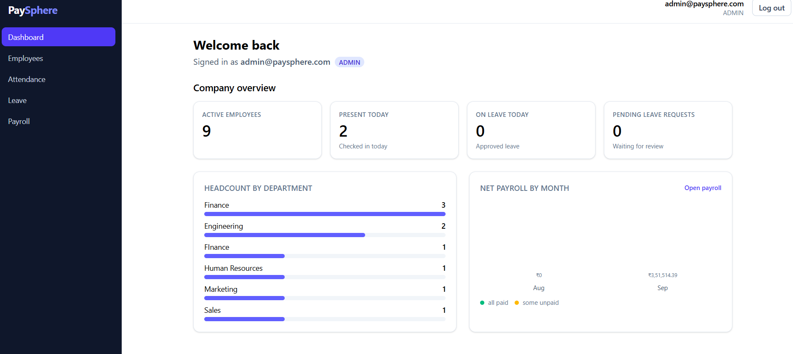
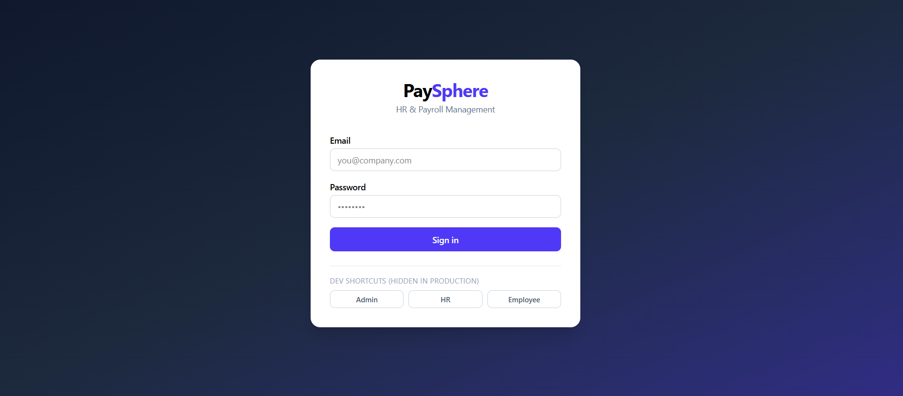
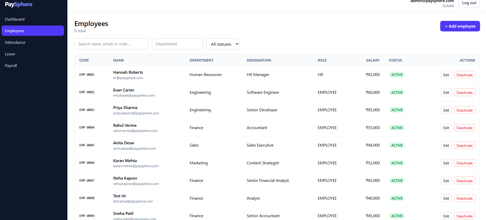
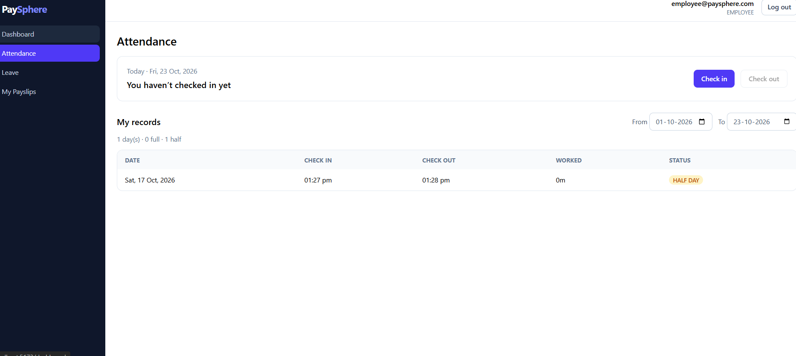
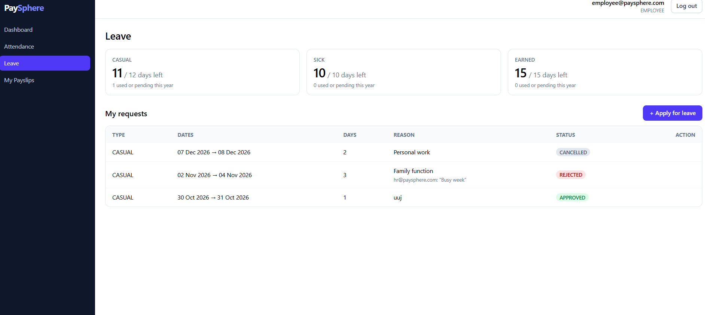
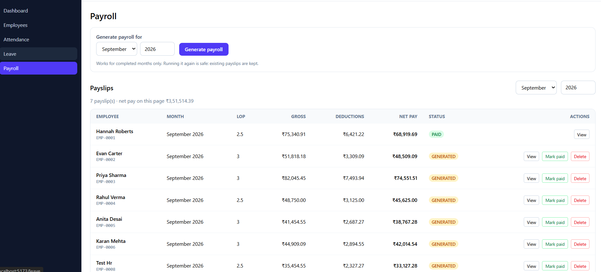
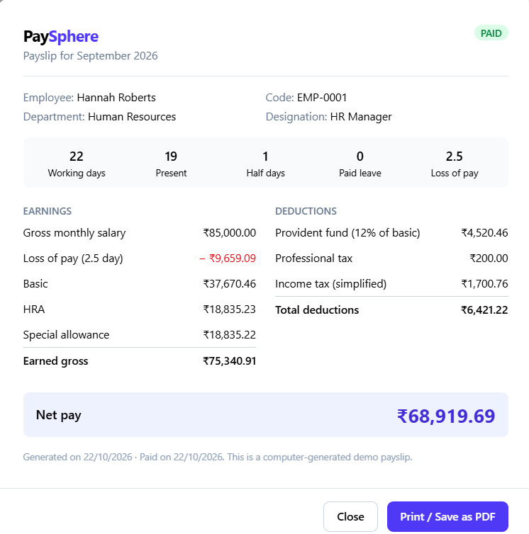

# PaySphere – HR & Payroll Management System

A full-stack HR and payroll application: manage employees, track attendance, handle leave requests and run monthly payroll with printable payslips. Built as a 12-day portfolio project with role-based access for **Admin**, **HR** and **Employee** users.



## Features

| Area | What it does |
|---|---|
| **Authentication** | Stateless JWT login, BCrypt-hashed passwords, three roles (ADMIN, HR, EMPLOYEE), method-level permission checks |
| **Employees** | Create, edit, search, filter and page through employees. Codes like `EMP-0001`. Deactivate and reactivate instead of deleting (soft delete). A deactivated user loses access immediately |
| **Attendance** | Check in and check out, half-day detection (under 4 hours), personal history, HR/Admin view with date and employee filters |
| **Leave** | Casual, sick and earned leave with yearly balances, weekday-only day counting, overlap and balance checks, cancel, approve and reject with comments |
| **Payroll** | Generate a month's payslips in one click, loss-of-pay from attendance and leave, PF, professional tax and a simplified income tax, mark paid, regenerate, printable payslip |
| **Dashboard** | Company overview for HR/Admin (headcount, present today, on leave, pending requests, payroll trend) and a personal overview for employees |

### Who can do what

| | Admin | HR | Employee |
|---|:---:|:---:|:---:|
| Create / edit / deactivate employees | all | employees only | – |
| Create HR accounts | yes | – | – |
| Check in / out, apply for leave, view own payslips | – (no employee profile) | yes | yes |
| View everyone's attendance | yes | yes | – |
| Approve / reject leave | all requests | employee requests only | – |
| Approve own leave request | – | – | – |
| Generate payroll, mark paid | yes | yes | – |

## Tech stack

- **Backend:** Java 17, Spring Boot, Spring Security + JWT (jjwt), Spring Data JPA / Hibernate, Flyway migrations, Bean Validation, springdoc-openapi (Swagger UI), Lombok, Maven
- **Database:** PostgreSQL 16 (Docker)
- **Frontend:** React 18, Vite, React Router, Axios, Tailwind CSS v4

## Project structure

```
Paysphere/
├── backend/                 Spring Boot API
│   └── src/main/
│       ├── java/com/paysphere/
│       │   ├── config/        security, CORS, OpenAPI, demo data seeders
│       │   ├── controller/    REST endpoints
│       │   ├── service/       business rules (leave, payroll, attendance …)
│       │   ├── repository/    Spring Data JPA repositories
│       │   ├── entity/        JPA entities and enums
│       │   ├── dto/           request / response records
│       │   ├── security/      JWT service and request filter
│       │   └── exception/     global error handling
│       └── resources/db/migration/   Flyway SQL (V1 … V5)
├── frontend/                React single-page app
│   └── src/
│       ├── api/               Axios client with token handling
│       ├── context/           authentication state
│       ├── components/        layout, route guard, forms, payslip view
│       └── pages/             Login, Dashboard, Employees, Attendance, Leave, Payroll, My Payslips
└── docs/screenshots/        images used in this README
```

## Getting started

### Prerequisites
- JDK 17
- Node.js 18 or newer
- Docker Desktop
- IntelliJ IDEA (or any Java IDE) for the backend

### 1. Start PostgreSQL

```bash
docker run --name paysphere-db -e POSTGRES_PASSWORD=postgres -e POSTGRES_DB=paysphere -p 5433:5432 -d postgres:16
```

Later, start it again with `docker start paysphere-db`. Don't delete the container, or the data goes with it.

### 2. Run the backend

Open the `backend` folder in your IDE and run `PaysphereApplication`, or from a terminal:

```bash
cd backend
./mvnw spring-boot:run        # macOS / Linux
mvnw.cmd spring-boot:run      # Windows
```

Flyway creates all tables on first start, and demo users and data are seeded. The API runs on **http://localhost:8080** and the interactive docs are at **http://localhost:8080/swagger-ui.html**.

Settings can be overridden with environment variables (see `backend/src/main/resources/application.yml`): `DB_URL`, `DB_USERNAME`, `DB_PASSWORD`, `JWT_SECRET`, `CORS_ORIGINS`, `ADMIN_EMAIL`, `ADMIN_PASSWORD`, `SEED_DEMO_USERS`.

### 3. Run the frontend

```bash
cd frontend
npm install
npm run dev
```

Open **http://localhost:5173**. If your backend is not on port 8080, copy `.env.example` to `.env` and set `VITE_API_URL`.

### Demo accounts

| Role | Email | Password |
|---|---|---|
| Admin | `admin@paysphere.com` | `Admin@123` |
| HR | `hr@paysphere.com` | `Hr@12345` |
| Employee | `employee@paysphere.com` | `Emp@12345` |
| Employee | `priya.sharma@paysphere.com` | `Emp@12345` |

The login page also has one-click buttons for the first three accounts in development mode. These accounts are demo data only. Set `SEED_DEMO_USERS=false`, and change `ADMIN_PASSWORD` and `JWT_SECRET`, for anything that is not a local demo.

## How the main rules work

**Leave**
- Balances per year: Casual 12, Sick 10, Earned 15 days.
- Only Monday to Friday count as leave days. A request must stay within one calendar year, cannot start in the past and cannot overlap another pending or approved request.
- Pending and approved leave both use up balance. Cancelled and rejected leave do not.
- Nobody can review their own request. Requests from HR accounts need an Admin.

**Payroll** (simplified demo rules, not tax advice)
- Payroll can only be generated for a completed month, and running it twice never creates duplicates.
- Loss of pay = monthly gross ÷ working days × days without attendance or approved leave. A half day counts as half.
- Earned gross is split into Basic 50%, HRA 25% and Special allowance 25%.
- Provident fund = 12% of Basic. Professional tax = ₹200 when earned gross is above ₹15,000. Income tax = 10% of the yearly amount above ₹7,00,000, spread over 12 months.
- A payslip can be deleted and regenerated until it is marked paid.

## API overview

All endpoints except login need an `Authorization: Bearer <token>` header. Full details are in Swagger UI.

| Area | Endpoints |
|---|---|
| Auth | `POST /api/auth/login`, `GET /api/account/me` |
| Employees | `GET/POST /api/employees`, `GET/PUT/DELETE /api/employees/{id}`, `PATCH /api/employees/{id}/activate`, `GET /api/employees/me` |
| Attendance | `POST /api/attendance/check-in`, `POST /api/attendance/check-out`, `GET /api/attendance/today`, `GET /api/attendance/me`, `GET /api/attendance` |
| Leave | `POST /api/leaves`, `GET /api/leaves/me`, `GET /api/leaves/balance`, `DELETE /api/leaves/{id}`, `GET /api/leaves`, `PATCH /api/leaves/{id}/approve`, `PATCH /api/leaves/{id}/reject` |
| Payroll | `POST /api/payroll/generate`, `GET /api/payroll`, `GET /api/payroll/me`, `GET /api/payroll/{id}`, `PATCH /api/payroll/{id}/pay`, `DELETE /api/payroll/{id}` |
| Dashboard | `GET /api/dashboard/overview`, `GET /api/dashboard/me` |

Errors always come back in one shape: `timestamp`, `status`, `error`, `message`, `path` and `fieldErrors` for validation problems.

## Screenshots

| | |
|---|---|
|  |  |
|  |  |
|  |  |

## Design decisions

- **Soft delete for employees.** Payroll and attendance history must survive, so deactivation disables the login instead of removing rows.
- **Server-side permission checks.** Hiding a button is only cosmetic. Every rule (who can review leave, who can create HR accounts) is enforced in the API.
- **Database migrations with Flyway.** The schema changes are versioned SQL files, and Hibernate only validates them.
- **No chart library.** The dashboard charts are plain HTML and CSS to keep the frontend small.

## Possible next steps

- Public holidays and a company calendar
- Email notifications for leave decisions and payslips
- Refresh tokens and a change-password screen
- Automated tests (service-level unit tests and API integration tests)
- Docker Compose for one-command startup

## License

MIT, see [LICENSE](LICENSE).
